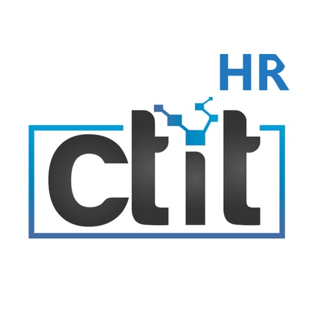
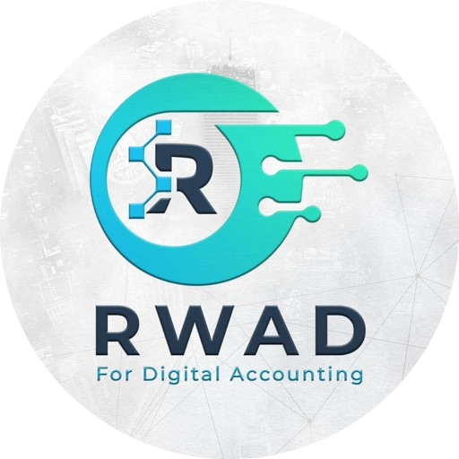
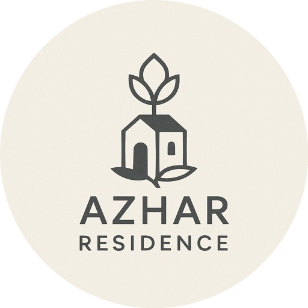
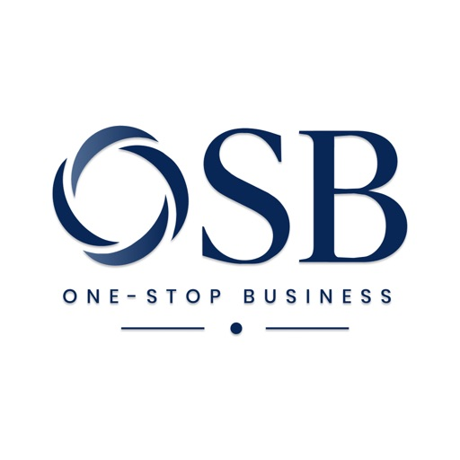

<!-- ═══════════════════════════  HEADER  ═══════════════════════════ -->
<p align="center">
  
</p>

<p align="center">
  <a href="https://git.io/typing-svg">
    
  </a>
</p>

<p align="center">
  <a href="https://linkedin.com/in/mohammedhedaya"></a>
  <a href="mailto:muhammedhedaya410@gmail.com"></a>
  <a href="https://wa.me/201030019598"></a>
  <a href="https://drive.google.com/file/d/1Gd1tmfemqbLELW-fSoH6Eak8S47uIzLi/view?usp=sharing"></a>
</p>

<p align="center">
  
  
  
</p>

<br/>

<!-- ═══════════════════════════  IMPACT  ═══════════════════════════ -->
<table align="center">
  <tr>
    <td align="center" width="170"><h2>5</h2><sub>Production apps<br/>shipped</sub></td>
    <td align="center" width="170"><h2>9</h2><sub>Live store<br/>listings</sub></td>
    <td align="center" width="170"><h2>2</h2><sub>Platforms<br/>Android · iOS</sub></td>
    <td align="center" width="170"><h2>AR / EN</h2><sub>Full RTL<br/>localization</sub></td>
  </tr>
</table>

<br/>

<!-- ═══════════════════════════  ABOUT  ═══════════════════════════ -->
## 👨‍💻 About Me

<table>
<tr>
<td width="55%" valign="top">

I'm a **Mobile Engineer at CTIT** who owns Flutter apps **end-to-end** — from architecture and testing all the way to the store release.

I care about apps that **real people rely on every day**: HR platforms, business services, community management and e-commerce — built to scale with the teams that maintain them.

- 🏗️ **Feature-first Clean Architecture** with BLoC / Cubit
- 📞 **Real-time in production** — VoIP voice & video, group calls, screen sharing, live chat
- 🔌 **Integrations** — Odoo ERP, REST, Firebase, WebRTC, payment gateways
- 🧪 **Quality** — unit, widget & parsing tests + CI/CD pipelines
- 🌐 **Arabic / English** apps with full RTL support

</td>
<td width="45%" valign="top">

```dart
class MohammedHedaya extends Engineer {
  final role     = 'Mobile Engineer @ CTIT';
  final location = 'Egypt 🇪🇬 · Remote';

  final stack = [
    'Flutter', 'Dart', 'Kotlin',
    'Firebase', 'WebRTC', 'Odoo',
  ];

  final principles = [
    'Clean Architecture',
    'BLoC / Cubit',
    'Test before you ship',
  ];

  @override
  bool get openToWork => true; // 🚀
}
```

</td>
</tr>
</table>

<!-- ═══════════════════════════  APPS  ═══════════════════════════ -->
## 📱 Apps I've Built & Shipped

<table>
<tr>
<td width="50%" valign="top" align="center">
  
  <h3>CTIT HR</h3>
  <sub><i>Workplace HR & real-time communication platform</i></sub>
  <p align="left">
  📍 Check-in / out & attendance tracking<br/>
  💬 Internal team chat with full messaging<br/>
  📞 In-app <b>voice & video VoIP</b> with group calling<br/>
  🖥️ <b>Screen sharing</b> during calls + foreground services<br/>
  📋 Tasks, approvals & break management
  </p>
  <a href="https://play.google.com/store/apps/details?id=com.ctit.hr"></a>
  <a href="https://apps.apple.com/us/app/ctit-hr/id6770024831"></a>
</td>
<td width="50%" valign="top" align="center">
  
  <h3>Rwad HR</h3>
  <sub><i>Complete employee self-service platform</i></sub>
  <p align="left">
  📍 <b>Geo-verified</b> attendance + <b>biometric</b> login<br/>
  🗓️ Leave requests, balances & missions<br/>
  💰 Expenses, petty cash & receipt uploads<br/>
  💵 Payroll, payslips & salary advances<br/>
  📦 Material requests & purchase requisitions
  </p>
  <a href="https://play.google.com/store/apps/details?id=okteck.rwadhr.app"></a>
  <a href="https://apps.apple.com/us/app/rwad-hr/id6794373811"></a>
</td>
</tr>
<tr>
<td width="50%" valign="top" align="center">
  
  <h3>Azhar</h3>
  <sub><i>Residential community management</i></sub>
  <p align="left">
  🔧 Maintenance requests with photos & live status<br/>
  📝 Complaints & suggestions workflow<br/>
  🏠 Leases, rentals & installment tracking<br/>
  📢 Announcements, documents & push notifications
  </p>
  <a href="https://play.google.com/store/apps/details?id=com.oktech.azhar"></a>
  <a href="https://apps.apple.com/us/app/azhar/id6827115656"></a>
</td>
<td width="50%" valign="top" align="center">
  
  <h3>OSB · One Stop Business</h3>
  <sub><i>All business services in one platform</i></sub>
  <p align="left">
  🏢 Commercial registrations & licenses<br/>
  📊 Zakat, tax, insurance & legal services<br/>
  📂 Company documents upload & management<br/>
  🌐 Full <b>Arabic / English (RTL)</b> support
  </p>
  <a href="https://play.google.com/store/apps/details?id=com.oktech.ach"></a>
  <a href="https://apps.apple.com/us/app/osb/id6826558279"></a>
</td>
</tr>
<tr>
<td colspan="2" align="center">
  
  <h3>Selection Coffee &nbsp;</h3>
  <sub><i>Specialty coffee e-commerce & roastery app</i></sub>
  <br/><br/>
  ☕ Coffee by origin, process & roast level &nbsp;·&nbsp; 🎯 Taste-matched coffee advisor<br/>
  🛒 Cart, saved addresses & live order tracking &nbsp;·&nbsp; ⭐ Loyalty points & coupons<br/>
  📦 Wholesale ordering for cafés &nbsp;·&nbsp; 🌐 Full Arabic / English support
  <br/><br/>
  <a href="https://apps.apple.com/app/selection-coffee/id6832243752"></a>
  
</td>
</tr>
</table>

<!-- ═══════════════════════════  HIGHLIGHTS  ═══════════════════════════ -->
## ⚡ Engineering Highlights

<details open>
<summary><b>📞 Real-time communication at production scale</b></summary>
<br/>

Built in-app **VoIP voice & video calling** with group calls and **screen sharing**, kept alive in the background with **foreground services** — plus a full internal chat system, all shipped inside a live HR product.
</details>

<details>
<summary><b>🏗️ Architecture that teams can scale</b></summary>
<br/>

Feature-first **Clean Architecture** with **BLoC / Cubit**, clear separation between data, domain and presentation, so new features land without breaking old ones.
</details>

<details>
<summary><b>🔌 Enterprise integrations</b></summary>
<br/>

Deep **Odoo ERP** integration powering HR, payroll, expenses and procurement flows, alongside REST APIs, Firebase, WebRTC and payment gateways.
</details>

<details>
<summary><b>🧪 Ship with confidence</b></summary>
<br/>

Unit, widget & parsing tests backed by **CI/CD** build pipelines — from pull request to store release.
</details>

<!-- ═══════════════════════════  STACK  ═══════════════════════════ -->
## 🛠️ Tech Stack

<p align="center">
  
  <br/>
  
</p>

<p align="center">
  
  
  
  
  <br/>
  
  
  
  
</p>

<!-- ═══════════════════════════  ANALYTICS  ═══════════════════════════ -->
## 📊 GitHub Analytics

<p align="center">
  
</p>

<p align="center">
  
  
</p>

<!-- Contribution snake (generated daily by .github/workflows/snake.yml) -->
<p align="center">
  <picture>
    <source media="(prefers-color-scheme: dark)" srcset="https://raw.githubusercontent.com/mohammedhedaya/mohammedhedaya/output/github-snake-dark.svg"/>
    <source media="(prefers-color-scheme: light)" srcset="https://raw.githubusercontent.com/mohammedhedaya/mohammedhedaya/output/github-snake.svg"/>
    
  </picture>
</p>

<!-- ═══════════════════════════  CTA  ═══════════════════════════ -->
<br/>

<div align="center">

### 💡 Have a mobile product to build — or a team that needs a Flutter engineer?

<a href="mailto:muhammedhedaya410@gmail.com"></a>

</div>


